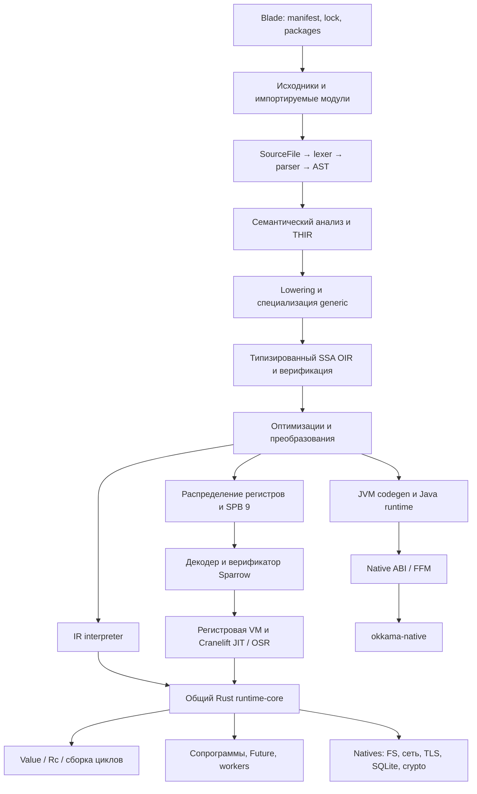

# Аудит Rust-реализации Okkama 0.3.3

Дата: **1 ноября 2026**. Ветка: **develop**. Коммит: **61f388bcca150554051331097c5edef89e82309d**.

Аудит охватывает архитектуру, границы доверия, корректность компилятора и VM, управление памятью, natives, пакетный менеджер, зависимости, тестирование и производительность. Код реализации не изменён. Созданы этот отчёт и материалы проверок; экспериментальные программы запускались на локальных временных данных.

Повторная проверка оптимизаций добавлена в **раздел 11**: две новые конкретные проблемы O11/O12, allocation counters, CPU profiles и ещё 300 differential-сравнений.

## 1. Главные выводы и порядок действий

**Первыми следует исправить Blade, обход сертификатов, живость регистров на исключительных переходах и проверить синхронизацию закрытия SQLite.** Ускорение арифметики сейчас менее важно, чем эти нарушения границ и корректности.

Обозначения: **подтверждено** — есть воспроизведение; **по коду** — установлен механизм или отсутствующая гарантия, но конечное последствие не воспроизведено; **гипотеза оптимизации** — выигрыш ещё нужно измерить. P0/P1/P2 — внутренний порядок работы, не CVSS. P0 здесь означает блокер выпуска затронутого компонента, а не доказанную критическую удалённую эксплуатацию.

| Очередь | ID | Проблема | Доказанность | Приоритет |
|---:|---|---|---|---|
| 1 | S01 | Имя пакета Blade позволяет записывать вне каталога установки | Перезапись локального контрольного файла воспроизведена | P0 |
| 2 | S02 | Перебор путей X.509 без бюджета: резкий рост времени на небольшом наборе сертификатов | Вызов native: 10 intermediates — 5,37 с; 11 — тайм-аут 8 с | P1 |
| 3 | S03 | JIT теряет старое значение регистра, нужное обработчику ошибки | Один проверенный SPB: interpreter возвращает 5, JIT — внутреннюю ошибку | P1 |
| 4 | S04 | SQLite: атомарный указатель не защищает время жизни соединения при interrupt/close | Сильное подозрение по коду; UAF не воспроизводился | P1, немедленная проверка |
| 5 | S05 | Зафиксированы версии криптографических зависимостей с актуальными RustSec advisory | Сопоставлены lock/metadata и RustSec | P1 |
| 6 | S06 | `okkama check` аварийно завершается на глубокой цепочке импортов | 16 000 простых модулей: SIGABRT, stack overflow | P1 |
| 7 | S07 | Освобождение разделяемого графа рекурсивно переполняет стек | Изолированная debug-проба: equality проходит, `drop` падает | P1 для устойчивости runtime |
| 8 | S08 | Реестр задач удерживает завершённые результаты и имеет квадратичную регистрацию | Удержание Weak-пробой и рост времени подтверждены | P1 для долгоживущих программ |
| 9 | S09 | Маленький SPB разворачивается в большой анализ потоков данных | 234 КиБ входа → около 132 МиБ RSS на `check` | P1 на недоверенном вводе |
| 10 | S10 | Нет общих бюджетов исполнения, памяти, потоков и специализаций | По коду, частично уже отражено в roadmap | P1 при встраивании/сервисах |
| 11 | S11 | Верификация типов, контракт помощников и ABI JIT остаются незакрытыми границами | По коду и существующему hardening-плану | P1 до доверия внешнему SPB |
| 12 | Q01 | Публикация пакетов не зависит от полного release gate | По GitHub workflows | P1 для процесса выпуска |
| 13 | Q02 | Установка пакетов и запись lockfile не образуют одну транзакцию | По коду; отказ записи не инъецировался | P2 |
| 14 | Q03 | Host environment/cwd привязаны к потоку, а не экземпляру VM | По коду; см. дополнительную пробу ниже | P2 |
| 15 | Q04 | Заявленный MSRV 1.85 не соответствует Cranelift с MSRV 1.97 | Cargo metadata | P2 |
| 16 | Q05 | Обычный debug workspace test и clippy не зелёные | Оба запуска воспроизведены | P2 |
| 17 | Q06 | Документация частично описывает старую архитектуру и завышает гарантии | Сопоставление документов с кодом | P2 |

Подтверждённого выполнения произвольного машинного кода или восстановления криптографического ключа аудит не установил. Потенциальная ошибка времени жизни SQLite не должна подаваться как уже воспроизведённая порча памяти.

## 2. Как устроен проект



В Rust workspace 11 crates, около **108 тыс. строк в 214 Rust-файлах**, включая тесты. Основная сложность сосредоточена в compiler (~52 тыс.), runtime-core (~29 тыс.), CLI (~7,9 тыс.), IR runtime (~5,7 тыс.) и Sparrow VM/JIT (~4,9 тыс.). Это размер исходников, а не утверждение о построчной формальной проверке.

Разделение компилятора, формата байткода, исполнителей, общего runtime и native ABI полезно: можно проверять границы отдельно. Есть OIR-верификация, набор conformance, несколько исполнителей, точные целые с быстрым i64-представлением, сборка циклов, регистровые ограничения JIT, лимиты глубины AST. Это уже существенная инфраструктура. Основные пробелы находятся **между** уровнями: исключительные переходы и liveness; завершение задач и владение; atomic pointer и lifetime; допустимое имя пакета и путь файловой системы.

Особенность проверки несколькими движками: IR и Sparrow разделяют runtime-core. Их совпадение не обнаруживает общий дефект natives, строк, чисел или планировщика. JVM полезен как дополнительная реализация, но часть native-кода также общая. Для отдельных операций нужен независимый оракул.

## 3. Безопасность и корректность — подробные находки

### S01. Blade: выход из каталога установки через имя пакета

**Статус: подтверждено.** При установке локального тестового пакета имя `../../victim` прошло проверку. Файл `victim/proof.txt`, расположенный вне проекта, заменился содержимым из пакета. Все пути принадлежали временному каталогу аудита; реальные файлы пользователя не затрагивались.

**Где:** `okkama-rs/crates/blade/src/manifest.rs:62`, `install.rs:337`, `install.rs:623`, `install.rs:703`.

`check_package` проверяет namespace объявлений только для файлов `.ok`. Пакет без таких файлов проходит этот цикл без проверки имени. При установке `staged.join(name)` интерпретирует компоненты имени как файловый путь. Проверка равенства ожидаемого и объявленного имени не подтверждает безопасность пути.

**Воздействие:** пакет, которому доверили установку, может менять файлы за пределами `pkg/` в пределах прав пользователя. Успешная установка возвращает код 0. Исследование подтвердило перезапись файла; дальнейшие последствия не проверялись.

**Исправление:** единая проверка грамматики имени на входе manifest/resolver; запрет абсолютных путей, `.` и `..`, пустых компонентов и иных недопустимых элементов. Если составные имена разрешены, каждый компонент должен быть допустимым идентификатором. Проверка назначения должна гарантировать нахождение внутри staging-каталога. Отдельно определить правила пересекающихся имён пакетов и коллизий регистра. Проверять имена независимо от наличия исходников.

**Приёмка:** тесты имени без `.ok`, абсолютного имени, относительных выходов, транзитивной зависимости, допустимого составного имени; контрольные файлы вне staging остаются прежними. Проверить взаимодействие с политикой симлинков. Доказательство: [blade-path-result.json](evidence/blade-path-result.json).

### S02. X.509: перебор путей не ограничен общим бюджетом

**Статус: подтверждён рост времени native-проверки; сетевой сценарий целиком не запускался.**

**Где:** `okkama-runtime-core/src/native/x509.rs:1711–1759`; вызов проверки из `native/tls.rs:467` и далее.

`issuers` выбирает кандидатов по issuer/subject и AKI/SKI. `search` обходит различные пути DFS, ограничивает длину пути и повтор одного DER внутри пути. Эти ограничения не ограничивают число перестановок разных подходящих сертификатов. Полная проверка пути вызывается при достижении якоря. Ограничение числа сертификатов само по себе не даёт разумной границы работы.

Локальная проба использовала самостоятельно созданные сертификаты: отдельный доверенный корень и набор разных DER с одинаковыми подходящими именами/идентификаторами издателя. Итог всегда был отказом в доверии. Измерялось время **внутри** `X509VerifyChain`:

| Промежуточных сертификатов | Время, с |
|---:|---:|
| 0 | 0,0084 |
| 4 | 0,0113 |
| 6 | 0,0169 |
| 8 | 0,0598 |
| 9 | 0,3102 |
| 10 | 5,3724 |
| 11 | Не завершилось за внешний тайм-аут 8 с |

Это одиночные диагностические замеры, не стабильные latency-перцентили. Вывод об алгоритмической проблеме основан также на структуре перебора. TLS authorization вызывает этот код синхронно; поэтому блокировка потока обработки на такой проверке — обоснованный вывод из кода, а не воспроизведённый сетевой инцидент.

**Исправление:** общий бюджет посещённых состояний/рёбер/проверок подписи; раннее отбрасывание невозможных переходов; ограничение совокупного входа. Рассмотреть проверенную реализацию построения цепочки вместо собственного поиска, предварительно сравнив семантику PKIX и контракт языка. Мемоизация должна учитывать ограничения пути, а не только сертификат. Перенос в worker уменьшает блокировку scheduler, но не устраняет неограниченную работу.

**Приёмка:** этот набор и варианты с неоднозначными издателями завершаются с определённым отказом в пределах лимита; корректные альтернативные цепочки продолжают проходить. [Замеры](evidence/certificate-scaling.json), [тайм-аут](evidence/certificate-limit.json), [DER fixtures](evidence/certs/), [native harness](evidence/runtime-probe.rs).

**Не найден обход доверия TLS:** ранний deferred verifier в rustls не означает, что проверка сертификата полностью выключена. В коде присутствуют последующая `authorize` и ограничения операций до завершения проверки. Называть этот механизм отключённой проверкой TLS было бы неверно.

### S03. Живость регистров JIT неверно учитывает исключительное ребро

**Статус: подтверждено на небольшом типизированном SPB, принятом верификатором.**

**Где:** `sparrow-vm/src/liveness.rs:80–96`; применение `live_after` при `move` в `jit.rs:1659`.

Старое строковое значение регистра нужно обработчику, если вызов завершается ошибкой до записи нового результата в этот регистр. Анализ сначала объединяет обычное и исключительное продолжения, затем исключает регистры, определяемые инструкцией, сразу для обоих путей. Тем самым старое значение ошибочно становится мёртвым. Более ранний JIT `move` переносит его с очисткой источника.

| Режим | Результат одного и того же SPB |
|---|---|
| `OKKAMA_JIT=off` | Код 5 — ожидаемая длина сохранённой строки |
| `OKKAMA_JIT=eager` | Код 1, `invalid interpreter state: expected string value` |

Статистика подтверждает реальное исполнение JIT: 2 скомпилированные функции, 2 входа. Воспроизводитель написан на Sparrow assembly; достижимость именно этого расположения регистров из текущего Okkama codegen отдельно не установлена.

**Исправление:** рассчитывать перенос данных отдельно для успешного и исключительного исхода. Удалять definition результата только там, где запись действительно произошла; затем объединять потребности продолжений. Уточнить семантику инструкций с частичными эффектами. Это важнее новых destructive-move оптимизаций.

**Приёмка:** [handler-liveness.spa](evidence/handler-liveness.spa) даёт одинаковый результат off/eager/threshold 2/10; добавить варианты с разными failure-инструкциями, cleanup, вложенными вызовами и OSR. [Результаты](evidence/handler-liveness.json).

### S04. SQLite: возможная гонка времени жизни при cancellation

**Статус: по коду; use-after-free не воспроизведён.**

**Где:** `okkama-runtime-core/src/native/sqlite.rs:1100–1123`, `1283–1291`, `1700–1716`.

Cancellation callback загружает `sqlite3*` из `AtomicPtr`, затем вызывает `sqlite3_interrupt`. Worker может обнулить atomic и закрыть соединение между загрузкой указателя и вызовом. `SeqCst` упорядочивает операции, но не удерживает объект живым. В коде очереди закрытие асинхронно, поэтому один только порядок сообщений worker не защищает callback на другом потоке.

SQLite прямо требует, чтобы соединение не было закрыто и не могло закрыться до возврата `sqlite3_interrupt`. Потокобезопасность interrupt не снимает этого требования. [Официальный контракт SQLite](https://www.sqlite.org/c3ref/interrupt.html).

**Следующий шаг:** детерминированный тест с барьером между load и interrupt, конкурентным close; затем ASan/TSan в подходящей сборке. Исправление должно синхронизировать весь участок удержания указателя с close, например отдельным lock/lifetime protocol. Нельзя просто заменить порядок атомиков. Нельзя держать этот lock на протяжении всего долгого SQL-запроса: это заблокирует нужный interrupt.

**Приёмка:** доказанный протокол времени жизни; тесты cancel/close/worker-exit и отсутствие обращений к освобождённому соединению. Из-за потенциального нарушения memory safety проверку нужно сделать раньше косметических изменений.

### S05. Криптографические зависимости требуют обновления и отдельного решения по RSA

Дата проверки базы: 2026-11-01. RustSec revision: `2295466c4e9df26647fd67d8fa1c705ac2fc7f81`. Сопоставлено 207 packages из Cargo metadata с локальной базой advisory; использовался Rust `semver`. **Это не запуск cargo-audit**: инструмент не установлен, применён отдельный небольшой сканер.

| В lockfile | Advisory | Решение согласно базе |
|---|---|---|
| `crypto-bigint 0.7.5` | RUSTSEC-2026-0387 | Исправлено начиная с 0.7.6 |
| `ctutils 0.4.2` | RUSTSEC-2026-0385 | Исправлено начиная с 0.4.4 |
| `rsa 0.10.0-rc.19` | RUSTSEC-2023-0071 | В базе нет исправленных версий |

Первые две записи касаются операций, заявленных как constant-time, но допускавших зависимость выполнения от секретных значений. Наличие уязвимой версии подтверждено; практическая утечка в Okkama не измерялась. [crypto-bigint](https://rustsec.org/advisories/RUSTSEC-2026-0387.html), [ctutils](https://rustsec.org/advisories/RUSTSEC-2026-0385.html).

Для RSA база описывает timing side channels и не исключает используемую prerelease-версию. В `okkama-native/src/ops.rs:786` есть **OAEP `decrypt_blinded`**, а не вызов открытого PKCS#1 v1.5 decrypt. Поэтому нельзя автоматически объявить конкретный Marvin-сценарий доказанным для публичного API Okkama. Нужно отдельно проверить гарантии OAEP, private operations и используемой версии; blinding сам по себе не доказывает отсутствие всех каналов. [RSA advisory](https://rustsec.org/advisories/RUSTSEC-2023-0071.html).

**Действия:** обновить совместимые transitive dependencies с обновлением lockfile; прогнать crypto/X.509/TLS и JVM FFM тесты; внедрить RustSec-проверку в CI. Для RSA определить применимые операции и при необходимости выбрать provider с подходящими гарантиями, не заменяя шифрование на самодельную реализацию. Материалы: [совпадения](evidence/dependency-advisories.json), [версии](evidence/dependency-versions.json), [сканер](evidence/advisories.rs).

### S06. Глубина графа импортов не ограничена глубиной AST

**Статус: подтверждено.** `okkama check` на цепочке из 16 000 коротких модулей завершился SIGABRT с `stack overflow`. Цепочки 300/1000/3000/6000 проходили. Увеличение глубины не означает сложный синтаксис: каждый файл очень мал.

**Где:** `okkama-compiler/src/lowering/modules.rs:150–210`. `imports_of` рекурсивно вызывает себя. `active.iter().position` также линейно ищет повтор на текущем пути.

AST nesting limit защищает отдельное дерево, но не рекурсию обхода файлов. Это противоречит сильной формулировке security-model о безопасной проверке произвольного исходника внутри процесса.

**Исправление:** итеративный DFS с явными кадрами; лимиты количества модулей, суммарных байтов и глубины зависимостей; HashSet для active membership при сохранении отдельного стека диагностики. Как минимальное исправление до итеративного обхода — ранний лимит глубины со структурированной ошибкой.

**Приёмка:** та же цепочка возвращает результат или понятный отказ без abort, в debug/release; цикл импортов сохраняет корректную диагностику. [6000 и меньше](evidence/import-depth.json), [16000](evidence/import-depth-large.json).

### S07. Уточнение H-40: падает освобождение, а не сравнение

**Статус: подтверждено изолированной пробой.** Полный debug `cargo test` падает на тесте `equality_is_iterative_and_reuses_shared_subgraphs`. Дополнительная программа на стеке 2 МиБ печатает:

```text
constructed
equal finished
self equal finished; dropping
... stack overflow ...
```

**Где:** `okkama-runtime-core/src/heap.rs:209–229`, `296–303`, тест с 1035. `ObjectHeap::equal` сам использует явную очередь и набор посещённых пар.

`take_deep` переносит в очередь только ссылки, у которых strong count уже равен 1. В контейнере `[child.clone(), child]` обе ссылки имеют count 2 во время прохода и остаются внутри. При обычном уничтожении элементов вторая становится последней и запускает следующий деструктор рекурсивно. Так возникает цепь вызовов при освобождении разделяемого DAG.

**Исправление:** освобождать потенциально глубокие значения через единую рабочую очередь, учитывая изменения strong count после снятия каждой ссылки. Не переписывать equality на основании имени падающего теста. Проверить Object/Array/Map/Any/builders/closures, а также взаимодействие со сборкой циклов и пользовательским destroy.

**Приёмка:** debug/release на ограниченном стеке, длинные цепочки и DAG с повторными рёбрами, ошибки посреди сравнения, освобождение GC. Release-прохождение текущего теста не доказывает отсутствия глубокой рекурсии на других размерах. [Проба](evidence/drop-probe.rs), [результат](evidence/drop-probe.json). Существующую H-40 следует уточнить, а не дублировать как полностью новую находку.

### S08. Scheduler удерживает завершённые задачи и квадратично регистрирует новые

**Где:** `okkama-runtime-core/src/sched.rs:113`, `368–375`, очистка реестра около `593–640`.

`registered` — `Vec<Future>`. Каждая регистрация ищет идентичный указатель линейно и сохраняет strong reference. Завершённые и уже наблюдённые futures не удаляются индивидуально; реестр очищается при завершении верхнего запуска/reset.

Проба создаёт уже разрешённые успешные futures, отмечает результат наблюдённым, регистрирует и удаляет локальную strong reference. Weak продолжает успешно upgrade до `sched::reset`, после reset — нет. Это подтверждает удержание, не только рост RSS.

| Количество | Время регистрации, с |
|---:|---:|
| 1 000 | 0,00083 |
| 4 000 | 0,00268 |
| 16 000 | 0,03883 |
| 32 000 | 0,15504 |
| 64 000 | 0,61883 |

Удвоение в последней части даёт примерно четырёхкратное время. Для долгоживущего server/main стоимость зависит от всей истории задач; удерживаются также результаты и достижимые из них объекты.

**Исправление:** отделить активные задачи, необработанные ошибки и пользовательские handles; O(1) membership по ID/индексу или подходящей таблице. Освобождать наблюдённые успешные завершения, не теряя гарантии обнаружения ненаблюдённых ошибок. Просто заменить Vec на HashSet недостаточно для памяти.

**Приёмка:** миллион последовательных завершений при постоянной конкурентности не наращивает число удерживаемых результатов; registration почти линейна; ненаблюдённая ошибка и cancellation продолжают работать. [Замеры](evidence/registry-scaling.json).

### S09. Размер SPB не ограничивает память верификации

**Где:** `okkama-sparrow/src/verify.rs:288` — bitset состояния на каждую инструкцию; `sparrow-vm/src/liveness.rs` — плотные таблицы uses/defs/live-in/live-out.

Синтетические функции содержали N регистров, N записей константы и return последнего регистра. Проверялся release `sparrow check`, без исполнения JIT. Три запуска на размер; RSS получен `os.wait4` дочернего процесса на macOS.

| N | SPB, байт | Медиана времени, мс | Максимальный RSS, МиБ |
|---:|---:|---:|---:|
| 1 000 | 6 922 | 4,12 | 2,88 |
| 4 000 | 27 922 | 4,21 | 5,08 |
| 16 000 | 111 922 | 9,38 | 35,80 |
| 32 000 | 239 541 | 26,93 | 131,72 |

На этом диапазоне время ещё небольшое, но память растёт примерно квадратично при совместном увеличении числа инструкций и регистров. Продолжать до OOM не требовалось. JIT-лимит числа регистров не защищает верификатор, который работает раньше; лимит входного файла 256 МиБ также не ограничивает размер рабочих таблиц.

**Исправление:** checked расчёт бюджета `instructions × words_per_register_set` до выделения, общий бюджет decoded program + analysis; при необходимости анализ по блокам, разреженные наборы и worklist. Лимиты должны действовать и для библиотечного `Program`, не только CLI decoder. [Исходные замеры](evidence/dataflow-scaling-verified.json).

Первый эксперимент через `/usr/bin/time -l` был непригоден из-за запрета `sysctl` в песочнице. В таблицу включён повторный корректный замер; ошибочный запуск не учитывался.

### S10. Ресурсная политика неполна

Это в основном уточняет уже открытые H-04/H-12/H-14/H-15:

- CPU-bound код не имеет общего fuel/deadline механизма; отмена Future не прерывает любой вычислительный цикл.
- Нет общего бюджета heap, register frames, pending jobs и generic specializations.
- `sched::offload` (`sched.rs:665–695`) создаёт отдельный OS thread на операцию; очереди не задают backpressure. SQLite дополнительно использует worker и ожидание ответа через offload.
- Стек сопрограммы резервируется размером 64 МиБ, cache сохраняет до 64 idle stacks; большой стек верхнего исполнения — 256 МиБ. Это **виртуальный резерв**, его нельзя автоматически считать RSS. Масштабирование по конкурентности всё равно требует измерения и лимитов.
- Intrinsic callbacks и destroy могут снова входить в VM через стек Rust, хотя обычные interpreter frames хранятся в куче.

**Действия:** общий ExecutionLimits/HostPolicy, счётчики задач и памяти, fuel на обратных рёбрах/вызовах, согласованные точки проверки в interpreter и JIT, лимиты затрат внутри тяжёлых natives. Для blocking I/O — ограниченный worker pool; для сокетов отдельно оценить event loop. Семантика cancellation, cleanup и starvation должна быть задана до замены scheduler.

Fuel и epoch-проверки — разные компромиссы точности и стоимости; их разделение есть, например, в [Wasmtime](https://docs.wasmtime.dev/examples-interrupting-wasm.html). Это инженерный ориентир, а не предложение перенести WebAssembly-архитектуру целиком.

### S11. Незакрытые контракты SPB/JIT

Существующие H-05/H-06/H-07 остаются актуальны:

1. Верификатор проверяет структуру, доступность регистров и control flow, но не полный контракт типов и арностей. JIT использует объявленные типы для работы со значениями. Runtime tag checks — полезная защита, но не замена верификации.
2. Помощникам нужен единый machine-readable контракт: чтение/запись, владение аргументами/результатом, allocation, failure, reentry, необходимость spill и сохранения корней. S03 показывает цену неявных эффектов.
3. Прямые offsets в `Value`, `Rc`, Object/Array требуют явно контролируемого ABI. `repr(C)` внешней структуры не фиксирует внутреннюю раскладку Rust-полей. [Rust Reference](https://doc.rust-lang.org/reference/type-layout.html).

Не следует записывать уже исправленные H-02/H-03/H-28 как новые дефекты: ограничения JIT на 16 384 регистра/кадр 1 МиБ, ограничения AST и бюджет графа конфликтов действительно присутствуют. Также аудит не доказал повреждение памяти простым несовпадением типов SPB: текущие проверки тегов мешают части таких сценариев. До закрытия контрактов рекомендация проекта запускать внешний SPB отдельно с JIT off остаётся обоснованной.

## 4. Надёжность сборки, установки и встраивания

### Q01. Release gate существует, но не является обязательной зависимостью публикации

В `.github/workflows/ci.yml` запускаются release Rust tests и conformance для IR/Sparrow/JVM. В `.github/workflows/packages.yml` job `publish` зависит только от `build`; этот workflow самостоятельно реагирует на push/tag. В проверенных YAML нет зависимости публикации от успешного полного gate того же SHA.

Сам `tools/gate/gate.sh` лучше обычной CI-матрицы: eager, пороги 2/10, проверка фактического JIT/OSR, inline std tests. Но:

- нет явного полного режима `OKKAMA_JIT=off` — он добавлен отдельно в этом аудите;
- debug-падение S07 не видно release-only проверке;
- conformance проверяется по последней строке stdout, код выхода напрямую не учитывается;
- после ошибки build выполнение продолжается и может использовать старый executable;
- известные std failures исключены из запрета выпуска, поэтому их нужно показывать в релизной сводке, а не скрывать за «зелёным gate».

**Исправление:** reusable обязательный workflow на точном публикуемом SHA; structured JSON + exit code вместо парсинга одной строки; прекращение после неуспешной сборки; явная матрица off/eager/OSR, debug-регрессии memory management, dependency audit. Проверять тот же артефакт, который публикуется. Настройки branch protection вне репозитория не инспектировались.

### Q02. `pkg/` и `blade.lock` обновляются неатомарно

`blade/src/install.rs:96–108`: сначала `swap_in`, затем `new_lock.write`. `swap_in` удаляет старый каталог до записи нового lockfile; `lock.rs:125` использует `fs::write`. Отказ записи lock оставляет новые пакеты со старым lock. Аварийное завершение при записи может оставить неполный lockfile. Дополнительно стоит проверить порядок изменения manifest относительно `Busy::take` в `add` при конкурирующих командах.

**Действия:** подготовить новые pkg/manifest/lock до commit; временная запись и rename lockfile; механизм rollback/recovery для согласованности нескольких файлов; блокировка на всю операцию. Один rename сам по себе не превращает несколько файлов в атомарную транзакцию. Приёмка — fault injection на стадиях записи/rename и конкурентные install/update. Этот аудит установил порядок операций, но такие отказы не инъецировал.

### Q03. Host state принадлежит потоку, а не запуску VM

`okkama-runtime-core/src/host.rs:17–48` хранит cwd/environment в thread-local `Option<State>`, инициализируемом один раз. В `sparrow-vm/src/machine.rs:1642–1665` reset применяется к scheduler, а не host state. `DEFAULTS` и команда worker также имеют более широкую область жизни.

Дополнительная проба установила контрольную виртуальную переменную, дважды выполнила отдельный вызов публичного `sparrow_vm::execute` и после обоих запусков получила прежнее значение. Она подтверждает отсутствие сброса, но не моделирует изоляцию разных OS-пользователей.

Для нынешнего документированного режима «доверенные программы, одна VM на поток» это прежде всего неявный контракт. Для переиспользуемого embedding API следующий клиент на том же потоке может наследовать состояние предыдущего. **Решение:** явный HostContext на VM/session либо документированная область session и явный reset. Не менять process-wide environment ради сброса. [Проба и результат](evidence/host-probe.json).

### Q04. MSRV и воспроизводимость toolchain

Workspace заявляет `rust-version = "1.85"`, но `cranelift-codegen 0.137.0` декларирует `rust_version = "1.97.0"`. На текущем rustc 1.97.1 сборка проходит; это не проверка поддержки 1.85. Есть также современные конструкции языка/API, требующие отдельной сверки.

**Действия:** выбрать фактический MSRV и согласовать workspace/dependencies; отдельный CI job на минимальной версии. Для выпуска фиксировать toolchain и lockfile. `stable` в workflow меняется со временем, что особенно существенно для ABI-проб JIT. Downgrade зависимостей ради старой цифры без тестов не рекомендуется.

### Q05. Debug и lint имеют отдельные дефекты

- `cargo test --workspace --locked --offline` остановился на S07; последующие тесты обычного workspace-прогона этим запуском не покрыты.
- `cargo clippy --workspace --all-targets --locked --offline` завершился ошибкой `clippy::approx_constant` в `native/math.rs:797`.
- Повтор с **единственным диагностическим разрешением** `-A clippy::approx_constant` успешно завершился, сохранив остальные предупреждения. Файлы/настройки lint не менялись.

Большинство предупреждений не являются уязвимостями. Из полезного: типы `transmute` в FFI лучше указывать явно, крупные Result/error types стоит измерить на горячих границах, фиктивные `forget` проверить на намерение автора. Массовое автоматическое исправление предупреждений не входит в приоритетный план. Для числовой константы сначала сверить требуемое округление с контрактом языка.

### Q06. Документация должна отражать фактические гарантии

`docs/security-model.md` стоит уточнить с учётом S06/S07/S09: in-process check не гарантирует отсутствие abort на всех графах импортов. Формулировки про рекурсию должны различать обычные вызовы VM, callbacks и освобождение данных.

README runtime-core/runtime-abi местами описывают прежний объём providers, отсутствие unwind или прежнюю модель хранения. Это опасно для последующего сопровождения unsafe-кода: разработчик может исходить из неверного инварианта. Приоритет — актуализировать ownership, lifetime, failure и reentry контракты, затем обзорные README.

## 5. Производительность: что измерено и где ожидается наибольший эффект

### 5.1. Базовая картина

Использован уже существовавший в рабочем дереве [отчёт бенчмарков 0.3.3](../../../benchmarks/reports/2026-11-01-v0.3.3/REPORT.md), привязанный к тому же коммиту. Он не перезаписывался. Машина: Apple M2 Max, 32 GiB, macOS/Darwin 26.5.2; rustc 1.97.1. В исходном отчёте — 10 запусков на пару после прогрева.

| Нагрузка | Sparrow JIT, с | Sparrow off, с | JVM, с | Что это показывает |
|---|---:|---:|---:|---|
| Арифметика | 0,050 | 0,172 | 0,282 | JIT уже существенно сокращает dispatch |
| Вызовы | 0,121 | 0,563 | 0,176 | Быстрые вызовы полезны |
| Float | 0,040 | 0,336 | 0,137 | Прямой машинный путь эффективен |
| BigInt | 0,177 | 0,181 | 0,332 | JIT почти не меняет итоговую стоимость |
| Строки | 0,039 | 0,048 | 0,117 | Выигрыш dispatch невелик |
| Коллекции | 0,074 | 0,211 | 0,217 | JIT помогает, но Python в этой задаче — 0,056 с |
| Объекты | 0,075 | 0,495 | 0,126 | Существующие оптимизации работают |
| Замыкания | 0,318 | 1,110 | 0,223 | Sparrow уступает JVM на этом workload |
| Прикладная задача | 0,301 | 0,968 | 0,520 | Есть значительная стоимость allocation/natives |

Показатель «2,79× быстрее Python» в исходном отчёте — геометрическое среднее **этого** набора. Он не доказывает превосходство на любых программах и не является сравнением чистого steady-state JIT всех платформ. Для JVM нужно отдельно учитывать startup, прогрев и GC. В существующей истории closures ухудшились примерно с 0,299 до 0,318 с; это повод для контролируемого bisect, а не доказательство причины регрессии.

Дополнительно выполнен повтор четырёх нагрузок на заранее скомпилированном SPB: один прогрев и пять измеренных отдельных процессов, off/default, без JIT_STATS. Выводы каждого повторения совпадали. Эти замеры отделяют компиляцию исходника от запуска VM, но включают startup, decoding и прогрев JIT нового процесса. Числа и все повторы: [focused-benchmarks-serial.json](evidence/focused-benchmarks-serial.json).

| Повтор аудита | Interpreter, с | JIT default, с | Отношение off/JIT |
|---|---:|---:|---:|
| 04-bigint | 0.1806 | 0.1763 | 1.02 |
| 06-collections | 0.2106 | 0.0720 | 2.93 |
| 09-closures | 1.1116 | 0.3193 | 3.48 |
| 10-app | 0.9780 | 0.3043 | 3.21 |

Повтор выполнен последовательно после завершения сборок и тестов аудита. Это wall-time отдельных процессов, а не аппаратно изолированный лабораторный benchmark.

### 5.2. Что реально делает JIT на этих программах

Отдельные диагностические запуски с `OKKAMA_JIT_STATS=1`:

| Нагрузка | Наблюдения |
|---|---|
| BigInt | 149 002 выхода в helper `int.add`, 11 001 `int.mul` |
| Collections | 708 321 `builder.push`, 106 002 `arr.lookup`, 102 007 `obj.new` |
| Closures | 49 005 `fn.closure`, 50 000 `builder.push` |
| App | 1 305 698 `obj.new`, 895 922 `builder.push`, примерно по 494 тыс. builder new/finish, 251 594 conversions |

App также показывает 163 182 изменения объекта на месте и только 1 567 копирований successor. Следовательно, «все successor всегда копируют объект» — неверный диагноз. И interpreter уже имеет запас до 256 свободных register frames; предложение «с нуля добавить frame pool» было бы повторением реализованного.

Счётчик helpers — **не CPU-профиль**: миллион дешёвых вызовов может стоить меньше одного дорогого. Здесь он используется для выбора измеряемых кандидатов. В первом проходе sampling-профилирование и allocation flamegraph не выполнялись. Во втором добавлены CPU samples и агрегированные allocation counters (§11); allocation flamegraph по-прежнему нет. [Логи](evidence/jit-stats-10-app.log).

### 5.3. Очередь оптимизаций — от ожидаемо наиболее полезных к мелким

Порядок — инженерная оценка по наблюдаемым нагрузкам, сложности и охвату. Точный выигрыш не обещан без прототипа и A/B. S08 и S09 идут перед этим списком: устранение квадратичности важнее процента скорости горячего цикла.

| № | Направление | Основание и ожидаемая польза | Стоимость / риск |
|---:|---|---|---|
| O11 | Убрать глобальный размер области динамических вызовов | Неисполняемая цель на 512 регистров замедляет исходный workload в 10,5 раза; §11.1 | Средняя; сохранить guards и cleanup |
| O12 | Использовать reuse кадров и аргументов на interpreter call.fn | 40,5 млн allocation requests на closures off; §11.2 | Средняя; captures, aliasing, unwind |
| O01 | Сократить промежуточные объекты, builders и упаковку результатов | Более 1,3 млн obj.new на app; большой потенциал сокращения allocation и Rc traffic | Средняя/высокая; порядок эффектов и destroy |
| O02 | Компактное хранение `@byte`, затем типизированных примитивных массивов | `Value` = 24 байта на этой сборке; массив байтов использует Vec<Value> | Высокая; затрагивает ABI/JIT/GC, максимум пользы на I/O |
| O03 | Удерживать скалярные значения в SSA-регистрах JIT между границами эффектов | Текущий слот Value и load/store создают работу на каждом шаге | Высокая; нужно сначала закрыть S03/S11 |
| O04 | Специализировать горячие вызовы замыканий и размер области вызова | Closures медленнее JVM; динамическая подготовка captures/слотов | Средняя/высокая; aliases, unwind, OSR |
| O05 | Оптимизировать операции больших чисел и конверсии по профилю | BigInt off≈JIT; interpreter dispatch здесь не главный резерв | Средняя; сохранить точную арифметику |
| O06 | Кэш разрешения/разбора импортов и улучшение CFG-анализов | Повторный parse до проверки module cache; DFS для каждого блока | Средняя; invalidation, imports/test mode |
| O07 | Убрать повторные полные проходы Unicode-строк | slice считает chars и отдельно ищет две границы | Низкая/средняя; индексируется code point, не байт |
| O08 | Разделить immutable compiled program и состояние запуска | new_engine клонирует Program, Prepared хранит Value на каждую инструкцию | Средняя; lifetime JIT и native context |
| O09 | Ограничить и настроить reuse больших буферов/стеков | Есть pools, но размер сохранённых capacities требует учёта | Низкая/средняя; удержание RSS против allocations |
| O10 | Constant folding, компактные инструкции, локальные мелкие правки | Полезны после устранения более крупных затрат | Разная; сначала доказать вклад |

**O01 — объекты и builders.** Начать с allocation counters по типу объекта и месту OIR, затем исследовать временные wrapper/iterator/result объекты и короткоживущие массивы. Fused операции и scalar replacement должны сохранять порядок вычисления, ошибки и destroy. Выделение объекта одним блоком вместо отдельных Rc header/полей — вариант для отдельного прототипа, не универсальная первая правка. Критерий: меньше allocated bytes/allocations на app/collections при неизменном результате и failure traces.

**O02 — массивы.** `heap::Array` хранит `Vec<Value>`, а преобразование bytes создаёт `Value::Byte` для каждого элемента. 1 МиБ сырых байтов требует примерно 24 МиБ только на слоты, до headers/copies. Это арифметика представления, а не измерение полного RSS или обещание ускорения в 24 раза. Выделенный byte buffer особенно полезен для файлов, сети, TLS/crypto и SQLite blobs. Нужно согласовать successor, slices, equality, native ABI и bytecode. Не переносить эту оптимизацию сразу на все типы.

**O03 — JIT.** Начать с одного basic block и доказанно plain int/float/bool. Spill перед helper, который может читать/менять register file, бросать ошибку, входить в VM или инициировать GC. Сохранять mapping для OSR и обработчиков. Сравнивать generated code, число loads/stores, compile time, code size и runtime; тестировать overflow promotion в BigInt. Встраивание всё большего числа helpers без модели эффектов усилит риск S03.

**O04 — closures.** `jit.rs:2394` повторно вызывает `closure_registers(program)` при генерации callsite, а область динамического вызова связана с максимальным подходящим кадром программы. Кэш вычисления максимума — небольшая локальная правка. Более важный эксперимент: guard по function identity для частых monomorphic callsites, точный размер кадра/captures и корректный fallback. Не отключать поддержку динамики ради бенчмарка.

**O05 — BigInt.** `IntValue` уже использует small i64 и общую ссылку на большие числа; это сохранять. Измерить размеры операндов, allocations, нормализацию, decimal conversions, рациональные числа и GCD. Совпадение off/JIT лишь указывает на низкую отдачу дополнительной борьбы с dispatch; оно не доказывает, какая именно операция внутри backend самая дорогая. Не менять exact int на фиксированное слово или float ради скорости.

**O06 — компилятор.** В `lowering/modules.rs` загрузчик возвращает уже разобранный AST, и только затем проверяется cache. CLI `main.rs:1135` заново читает и парсит файл. На графе с общими зависимостями это повторная работа. Разделить resolve identity и parse/cache; ключ учитывать canonical path, content/version, production/test mode, std namespace и LSP overlay. В `ir/hoist.rs:30` цикл ищется DFS из каждого блока: O(B·(B+E)), хотя есть ограничение 4096 блоков. SCC даёт линейную основу. Regalloc оценивать отдельно: уже есть защитный бюджет графа конфликтов, но нужны checker и измерение деградации fallback.

**O07 — строки.** `strings.rs:37` делает `chars().count()`, затем два прохода `char_indices().nth`. Для повторной индексации длинной Unicode-строки возможна квадратичная работа на уровне пользовательского цикла. Сначала один проход для обеих границ/ASCII fast path; более дорогой sparse index — только по профилю и с учётом памяти. Нельзя заменить code-point индекс на byte offset: это изменение языка.

**O08/O09 — reuse.** `machine.rs:97` клонирует Program, `Prepared::new` резервирует Value даже для инструкций без константы. Shared immutable program/compact constant pool могут помочь embedding и памяти больших программ, но JIT содержит ссылки на runtime context: кешировать машинный код между VM без проверки lifetime нельзя. Ограничивать pools не только количеством объектов, но суммарной capacity. Измерять cold startup, многократный запуск, steady state и retained memory отдельно.

**O10 — мелкие улучшения.** Folding чистых операций с точной семантикой overflow/NaN/error; таблица operator metadata вместо расходящихся списков; компактность instruction/operand storage; интернирование типов только после allocation profile. `BTreeMap` нельзя механически заменить HashMap: порядок ключей — наблюдаемая семантика. Переход на произвольный allocator, unsafe indexing или ручной SIMD без профиля сейчас не обоснован.

## 6. Результаты проверок

| Проверка | Результат | Ограничение интерпретации |
|---|---|---|
| Release workspace tests | **525 passed**, 62 успешных test-result summaries | Часть summaries — пустые/doc test suites; это не 62 содержательные бинарные нагрузки |
| Debug workspace tests | SIGABRT на S07 | Полный debug прогон не завершён |
| Conformance: IR, JVM, Sparrow default/eager/threshold 2/10 | По 790 PASS + 3 BLOCKED в основном прогоне | BLOCKED из-за запрета loopback bind в песочнице |
| Conformance: Sparrow off | 790 PASS + 3 BLOCKED | Дополнительный полный прогон |
| Три loopback conformance-кейса, вне песочницы | Все 3 PASS в каждом из 7 режимов | Отдельные отфильтрованные запуски; остальные 790 имеют NOT_RUN в этих отчётах |
| Объединённое покрытие conformance | **793 разных кейса прошли для каждого из 7 режимов** | Объединение основного и дополнительного запуска, не один зелёный gate |
| Std inline | 232 модуля × 2 движка = 464 запуска | Первоначально 4 failed, включая 2 известных collation и 2 TCP |
| TCP inline после разрешения loopback | IR и Sparrow PASS | Два новых отказа первоначального gate объяснены средой |
| Остаток std failures | 2 известных `std/locale/collation.ok` | Это остающиеся failures, не исправлены аудитом |
| JIT/OSR evidence | В gate есть compiled>0 и osr>0 | Подтверждает использование режима, не полноту покрытия |
| 1500 мутаций/усечений SPB | 0 crashes/timeouts, 9 accepted | Ограниченный seed/corpus; не coverage-guided fuzzing |
| 200 generated arithmetic programs | off/eager совпали с Python exact-int oracle | Небольшая арифметическая подмножина, не весь язык |
| Обычный clippy | FAIL: approx_constant | Не маскируется как успешный lint |
| Clippy с одним разрешением lint | Завершился, остальные warnings сохранены | Разрешение только для завершения аудита |
| RustSec | 3 совпадения зависимостей | Самостоятельный scanner, не cargo-audit |

Первоначальный `gate.sh` завершился **GATE FAILED**. Повторные сетевые проверки уточнили причину; исходный лог сохранён без редактирования. Фильтр `--case L11.tcp` запускает только три кейса, поэтому OCS даёт ненулевой общий код из-за 790 NOT_RUN; судить о повторе нужно по трём результатам, а не объявлять полный release gate прошедшим.

Материалы: [gate.log](evidence/gate.log), [release tests](evidence/cargo-test-release.log), [debug tests](evidence/cargo-test.log), [off conformance](evidence/conformance-sparrow-off.log), [loopback повторы](evidence/loopback-results-verified.json), [decoder smoke](evidence/decoder-fuzz.json), [arithmetic differential](evidence/arithmetic-differential.json), [clippy](evidence/clippy-complete.log).

## 7. Какие проверки нужно встроить в разработку

1. **Регрессии подтверждённых дефектов:** S01/S02/S03/S06/S07/S08/S09 с небольшими воспроизводимыми fixtures, определёнными лимитами и одинаковыми результатами в debug/release.
2. **Отдельная проверка оптимизатора:** OIR до/после каждого прохода, сравнение результата, отказов, stderr, cleanup и побочных эффектов. Structural verification недостаточна для сохранения смысла.
3. **Regalloc checker:** symbolic values на рёбрах, phi/parallel moves, exception edges, spills; генератор с сокращением контрпримеров. Несколько backend-проходов могут одинаково принимать ошибочное распределение.
4. **Coverage-guided fuzzing:** lexer/parser, SPB decode/verify, well-typed SPB execution, valid source → OIR → engines. Малые бюджеты subprocess, seed corpus и shrinker. Мутации байтов и генерация корректных программ решают разные задачи.
5. **Heap/GC stress:** deterministic collect-on-every-allocation, DAG/cycles, closures, failed initialization, finalizers и nested callbacks. Miri для совместимого core без JIT/FFI; ASan/TSan для поддерживаемых native-компонентов и SQLite cancellation.
6. **CI gates:** off/eager/threshold матрица, OSR evidence, targeted debug suite, dependency scan, MSRV; обязательная связь с публикацией.
7. **Performance gate:** артефакт, SHA, toolchain, входы, output checksum, все повторы, медиана и разброс; cold startup/compile/steady state отдельно. Для CPU-профиля — sampling; для heap — число/байты allocation и retained memory. Счётчики helpers дополняют их.
8. **Контракты фаз:** после каждой фазы документировать типизированность, допустимые IR формы, ownership, exceptional edges и лимиты. Assertions полезны внутри доверенной границы, структурированные ошибки — на внешнем вводе.

## 8. Рекомендуемая последовательность реализации

**Первый пакет — границы и корректность.** S01; обновления crypto dependencies с тестами; ограничение X.509 search; S03; проверка/исправление S04. Критерий — воспроизводители закрыты, gate не ухудшен, исключительные пути не теряют данные.

**Второй пакет — устойчивость.** Итеративный import walk и общий compilation budget; исправление DAG release; registry cleanup; analysis memory budget. Критерий — предсказуемая работа на размерах из отчёта и отсутствие abort/неограниченного удержания.

**Третий пакет — контроль качества.** Release workflow dependency, debug regressions, off/eager differential, регalloc checker, fuzzing, обновление security-model. Это предотвращает повторное появление тех же классов ошибок.

**Четвёртый пакет — ускорение.** С учётом повторного прохода сначала локальные пути вызовов O11/O12 и captures (см. §11), затем allocation profile app/collections, отдельный byte-buffer эксперимент и более широкий JIT scalar SSA. Каждый эксперимент — отдельный минимальный diff с корректностью и A/B; принимать только измеренный выигрыш на нескольких нагрузках без неприемлемого compile time/RSS.

Существующие H-01…H-40 не следует переписывать как сорок новых находок. Новые конкретные задачи этого прохода: package-name containment, X.509 work budget, exceptional liveness, SQLite close/interrupt lifetime, import-depth limit, completed-future retention и dependency update. H-40 нужно переименовать/уточнить по доказанному месту падения; H-11/H-39 усилить количественными данными.

## 9. Область покрытия и пределы выводов

Прочитаны архитектурные документы, security-model, hardening roadmap и ключевые реализации frontend/lowering, OIR passes, SPB/VM/JIT, heap/GC/scheduler, natives и Blade; исследованы workflows, dependency metadata и бенчмарки. Проверки охватили workspace release tests, все conformance-профили указанной матрицы, inline std и дополнительные локальные контрпримеры.

Это **не формальное доказательство безопасности всего проекта**. Не выполнены: построчная независимая проверка всех ~108 тыс. строк; криптоанализ алгоритмов; длительное coverage-guided fuzzing; Miri (нет доступного компонента на установленном stable); ASan/TSan; проверка Linux/x86_64 на этой машине; аудит настроек GitHub вне репозитория; crash-injection installer; полноценная проверка каждого C/FFM ABI на всех платформах; allocation flamegraphs; полноценный CPU-профиль всего набора workloads (во втором проходе сняты короткие samples только closures). Эти ограничения не отменяют подтверждённые дефекты и не дают оснований считать непроверенные области безопасными.

Текущая разумная граница использования: доверенный локальный код и процессы с внешними лимитами там, где ввод недоверенный. Перед заявлением о безопасном in-process embedding нужны ресурсная политика, границы natives, изоляция состояния и закрытие перечисленных lifetime/abort проблем.

## 10. Навигация по коду и материалам

- [Blade install](../../../okkama-rs/crates/blade/src/install.rs), [manifest](../../../okkama-rs/crates/blade/src/manifest.rs), [lock](../../../okkama-rs/crates/blade/src/lock.rs).
- [X.509](../../../okkama-rs/crates/okkama-runtime-core/src/native/x509.rs), [TLS](../../../okkama-rs/crates/okkama-runtime-core/src/native/tls.rs), [SQLite](../../../okkama-rs/crates/okkama-runtime-core/src/native/sqlite.rs), [crypto ops](../../../okkama-rs/crates/okkama-native/src/ops.rs).
- [Liveness](../../../okkama-rs/crates/sparrow-vm/src/liveness.rs), [JIT](../../../okkama-rs/crates/sparrow-vm/src/jit.rs), [VM](../../../okkama-rs/crates/sparrow-vm/src/machine.rs), [SPB verifier](../../../okkama-rs/crates/okkama-sparrow/src/verify.rs).
- [Heap](../../../okkama-rs/crates/okkama-runtime-core/src/heap.rs), [scheduler](../../../okkama-rs/crates/okkama-runtime-core/src/sched.rs), [host](../../../okkama-rs/crates/okkama-runtime-core/src/host.rs), [strings](../../../okkama-rs/crates/okkama-runtime-core/src/strings.rs).
- [Imports](../../../okkama-rs/crates/okkama-compiler/src/lowering/modules.rs), [CLI loader](../../../okkama-rs/crates/okkama-cli/src/main.rs), [hoisting](../../../okkama-rs/crates/okkama-compiler/src/ir/hoist.rs).
- [Модель доверия](../../security-model.md), [существующий hardening-план](../../roadmap/hardening.md), [CI](../../../.github/workflows/ci.yml), [публикация](../../../.github/workflows/packages.yml).
- [Воспроизведение и состав доказательств](REPRODUCING.md), [evidence](evidence/).

## 11. Повторная проверка оптимизаций — 1 ноября 2026

Повтор начат на **61f388bc**. Во время работы HEAD стал **2f669ba7** (`make report`); `git diff 61f388bc HEAD -- okkama-rs` пуст, то есть Rust-реализация та же. Изменений реализации этим аудитом нет. Ниже — новые результаты, а не замена исходных логов. Добавлены две конкретные проблемы производительности (**O11, O12**), количественные проверки O01/O02/O06/O07 и CPU sampling. Материалы собраны в [optimization-recheck](evidence/optimization-recheck/), сводные медианы и диапазоны — [summary.json](evidence/optimization-recheck/summary.json).

### 11.1. O11: размер невызываемого замыкания замедляет чужие вызовы до 10,5 раза

**Статус: подтверждено на проверенном SPB. Приоритет: первый локальный кандидат на исправление производительности JIT после S03/S11.**

Из исходного `09-closures.spb` получен assembly. К нему добавлены невызываемые функции: функция с N регистрами и фабрика, содержащая `fn.closure` на неё. Entry point и весь исполняемый workload сохранены. Ни фабрика, ни новая функция не исполняются. Все варианты проходят сборку/верификацию и выдают одинаковый stdout; отдельно проверен interpreter off.

Один прогрев и три измерения каждого варианта, прямой/обратный порядок чередовался. Медианы отдельного процесса Sparrow с JIT default:

| Вариант | Время, с | К исходному |
|---|---:|---:|
| Исходный | 0,3223 | 1,00× |
| Добавлена цель замыкания с 16 регистрами | 0,3568 | 1,11× |
| С 128 регистрами | 1,0872 | 3,37× |
| С 512 регистрами | 3,3829 | **10,50×** |
| С 513 регистрами | 0,4780 | 1,48× |
| Контроль: функция с 513 регистрами, **без** `fn.closure` на неё | 0,3207 | 1,00× |

**Причина:** `sparrow-vm/src/jit.rs:800` ищет максимальное число регистров всех целей `fn.closure` во всей программе. `closure_call` около 2392 использует этот максимум на каждом динамическом вызове и инициализирует соответствующую область. `invoke_area` около 2362 освобождает для динамической цели все `count` слотов, а не только фактический размер вызванной функции. Неисполняемая большая цель увеличивает работу на каждом маленьком вызове. При максимуме >512 `closure_registers` возвращает 0, и быстрый путь отключается глобально.

Статистика добавляет контроль механизма: у исходного варианта и N=512 одинаковы `compiled=6`, `entries=864`, `osr=1` и перечисленные instruction-helper counts. При N=513 появляется **10 247 019 `call.fn`** выходов в общий путь. Новые функции не становятся горячими, а отсутствие `fn.closure` в контрольном варианте снимает замедление. Следовательно, это не просто стоимость добавленного размера файла или компиляции дополнительных функций.

**Что изменить:** не связывать размер всех динамических вызовов с глобальным максимумом. Кандидаты: область малого фиксированного размера с проверкой реального callee и fallback только для большого callee; специализация callsite по допустимым целям; передача фактического размера для инициализации/очистки. Кэширование `closure_registers` ускорит компиляцию, но не устранит эту runtime-проблему. Сохранить проверки размера кадра, stack budget, failure cleanup и lifetime captures.

**Приёмка:** добавление холодной большой цели не меняет скорость существующего горячего callsite существенно; N=512/513 не вызывает глобального скачка стратегии; все варианты совпадают off/eager/OSR, включая отказы. Здесь измерено замедление, а не выигрыш ещё не реализованного исправления.

**Граница вывода:** это действительный сценарий VM/SPB. Аудит не доказал, что текущий Okkama frontend сохраняет именно такую недостижимую фабрику: lowering по достижимости может её удалить. Проблема также потенциально касается больших достижимых, но холодных замыканий; такой source-level сценарий отдельно не измерялся. [Результаты](evidence/optimization-recheck/closure-global-frame.json), [исходный assembly](evidence/optimization-recheck/closures-original.spa), [512](evidence/optimization-recheck/closures-extra-512.spa), [513 control](evidence/optimization-recheck/closures-extra-513-not-target.spa).

### 11.2. O12: общий путь `call.fn` интерпретатора обходит существующий пул кадров

**Статус: подтверждён allocation pressure; конкретные места выделений установлены по коду. Приоритет: первый кандидат для ускорения interpreter-only вызовов замыканий.**

Повтор уточнил прежнее замечание «frame pool уже есть». Он действительно есть, но `I::CallFn` в `machine.rs:1030` идёт через `evaluate`, копирует `captures` в Vec, отдельно получает Vec аргументов и расширяет первый. Затем `Step::Call` (`1450`) вызывает `call` (`748`), который создаёт `Frame::new`; тот выделяет новый `vec![Value::Undef; ...]` (`282`). Пул `spare` не передан этому пути. Освобождённый кадр может попасть в pool позже, но это не означает, что следующий такой вызов возьмёт его оттуда.

Глобальный Rust allocator-counter за один `execute` исходного closures benchmark:

| Режим | Alloc + alloc_zeroed + realloc calls | Сумма запрошенных размеров | Пик дополнительных живых Rust allocations |
|---|---:|---:|---:|
| Interpreter off | **40 502 244** | **3 668,83 МиБ** | 10,49 МиБ |
| JIT default | 138 804 | 23,98 МиБ | 10,51 МиБ |

Каждая комбинация проверена в трёх отдельных процессах; эти счётчики совпали между повторами. Это **не утечка на 3,6 ГиБ**: память постоянно освобождается и переиспользуется, а сумма отражает оборот выделений. Не весь разрыв можно автоматически приписать одному `Frame::new`: счётчик общий, без allocation stack traces. Однако конкретные промежуточные Vec и отсутствие reuse на данном пути видны непосредственно в реализации.

**Что изменить:** распространить reuse на обычный динамический вызов; заполнять регистры захватами и аргументами непосредственно, без цепочки временных Vec. Отдельно проверить fast-path `call.role` и другие вызовы, проходящие через тот же `Step::Call`. Не переносить значения разрушительно без корректной живости и правил aliasing; S03 показывает риск.

**Приёмка:** allocation calls на interpreter closures уменьшаются на порядок или до обоснованного нижнего предела, off/default сохраняют одинаковые результат и отказ; нет роста retained capacity после редкой большой функции. Точное ускорение требует реализации и A/B, в этом аудите оно не заявляется. [Счётчики](evidence/optimization-recheck/allocation-counters.json), [instrumentation harness](evidence/optimization-recheck/alloc_probe.rs).

### 11.3. CPU-профиль: стоимость captures и освобождения заметна даже с JIT

Получен двухсекундный macOS `sample` собственного процесса Sparrow. Для достаточной длительности в **копии SPB** увеличен главный цикл closures с 600 000 до 12 000 000; остальные тела функций сохранены. Это профиль вычислительного участка с меньшим относительным вкладом создания 50 000 counters, а не исходный latency benchmark.

В JIT default профиле 1652 снимка единственного показанного потока. По разделу **top of stack**, то есть без суммирования вложенных кадров:

| Функция на вершине стека | Снимков | Доля |
|---|---:|---:|
| `h_fn_frame` | 409 | 24,8% |
| `drop_glue<Value>` | 347 | 21,0% |
| `h_drop_range` | 213 | 12,9% |
| `Value::clone` | 126 | 7,6% |
| `h_drop` | 80 | 4,8% |

В сумме около **71% снимков** приходится на эти функции подготовки вызовов и работы со значениями. Это конкретно поддерживает O04: стоимость захватов, Rc clone/drop и очистки кадров нужно исследовать раньше общего «встроить ещё арифметику». Это не обещание ускорить программу на 71%: часть работы обязательна, профиль короткий и специализированный.

В отдельном off-профиле из 1662 снимков вершиной стека были `Frame::new` в 121 случае, `Vec<Value>::extend_with` в 75, клонирование Vec в 69, `mi_malloc_aligned` в 64, `mi_free` в 62 и `RawVecInner::finish_grow` в 40. Это дополнительно поддерживает O12; перечисление не суммируется в обещание ускорения.

Часть машинного кода JIT видна как `unknown binary`, поэтому точная атрибуция всех generated-code инструкций невозможна. Для дальнейшего анализа полезны JIT symbol registration/perf map и disassembly. Первоначально sample был запрещён песочницей; повтор для собственного дочернего процесса с разрешённым доступом прошёл. [JIT CPU sample](evidence/optimization-recheck/closures-cpu-sample.txt), [off CPU sample](evidence/optimization-recheck/closures-off-cpu-sample.txt).

### 11.4. Повтор базовых benchmark: прежний вывод сохраняется

Один прогрев и семь измерений на workload/mode, порядок off/default перемешан фиксированным seed, процессы запускались последовательно после сборки harness. Исходники и SPB исходных benchmarks не менялись. Вывод каждого запуска сверялся, совпадения между режимами проверены.

| Workload | Interpreter off, с | JIT default, с | off/JIT |
|---|---:|---:|---:|
| BigInt | 0,1809 | 0,1770 | 1,02× |
| Collections | 0,2137 | 0,0750 | 2,85× |
| Closures | 1,1289 | 0,3207 | 3,52× |
| App | 0,9807 | 0,3032 | 3,23× |

Небольшие отличия от первого аудита не названы регрессиями: коммит тот же, окружение не аппаратно изолировано, есть шум запусков. BigInt по-прежнему почти не выигрывает от JIT, а остальные три нагрузки — выигрывают. [Все 56 измерений](evidence/optimization-recheck/benchmarks-repeat.json).

### 11.5. Allocation counters уточняют O01/O05

Измерение отдельным бинарником с `GlobalAlloc`, который делегирует `System` и считает successful alloc/alloc_zeroed/realloc. Счётчики снимаются вокруг публичного `sparrow_vm::execute` **после** decode: включены clone Program, подготовка и JIT-компиляция, runtime и teardown. Для realloc суммируется полный новый запрошенный размер. Instrumentation меняет время выполнения — его latency не использовалась как benchmark. Не учтены обходящие Rust allocator native allocations, executable mappings и coroutine stacks. CLI использует **mimalloc**, а counter-harness — **System**: измерены запросы Rust-кода, а не внутренние расходы production allocator. Поэтому его память и latency нельзя напрямую приравнивать к RSS/скорости CLI.

| Workload / режим | Число запросов | Сумма размеров, МиБ | Пиковая дополнительная живая память, МиБ |
|---|---:|---:|---:|
| BigInt off | 337 984 | 1 101,31 | 0,27 |
| BigInt JIT | 341 647 | 1 103,44 | 0,69 |
| Collections off | 839 706 | 110,45 | 14,91 |
| Collections JIT | 295 078 | 94,91 | 14,82 |
| App off | 6 958 581 | 607,86 | 1,01 |
| App JIT | 5 480 727 | 347,60 | 3,54 |

**Новые основания для выбора работ:**

- На app allocation calls остаются миллионами даже с JIT — гипотеза O01 получила прямое измерение, но конкретные типы временных объектов ещё требуют allocation traces.
- BigInt пропускает через allocator около 1,1 ГиБ запросов при пике менее 1 МиБ. Полезно исследовать временные limb buffers, повторные вычисления и переходы к backend, а не считать проблему большим постоянно живым heap.
- Collections с JIT делает примерно в 2,85 раза меньше allocation requests, чем off. Поэтому его ускорение нельзя объяснить только удалением dispatch.
- Небольшой `retained_delta` после execute сам по себе не доказывает leak: могут сохраняться TLS/host caches. Для такого вывода нужен долгий повтор в одном процессе и граф удержания.

### 11.6. O02 подтверждён RSS: представление байтов дорого

Отдельный простой процесс удерживал N элементов `Vec<Value::Byte>` либо N элементов `Vec<u8>`; данные доступны через `black_box`, peak RSS собран `os.wait4`, три повтора. Это сравнение представлений в harness с System allocator, **не экспериментальная замена Okkama Array** и не полный RSS production CLI с mimalloc.

| Полезные байты | `Vec<u8>` RSS, МиБ | `Vec<Value::Byte>` RSS, МиБ |
|---:|---:|---:|
| 1 МиБ | 2,45 | 25,48 |
| 4 МиБ | 5,47 | 97,48 |

Разница согласуется с 24-байтным `Value`; базовый RSS процесса мешает получить ровно отношение 24×. Это усиливает приоритет компактного byte buffer для I/O. Нельзя переносить эти числа на RSS всей реальной программы или обещать равный выигрыш CPU. [Замеры](evidence/optimization-recheck/byte-memory.json).

### 11.7. O07 подтверждён: последовательный обход через `slice` квадратичен

Микропроба последовательно вызывает текущий runtime `strings::slice(s, i, i+1)` для каждой code point и суммирует длину результата в байтах. Это N независимых API-вызовов с повторным отсчётом от начала. Сравнивался эквивалентный для данной задачи однопроходный `chars()` checksum; строки и результаты проведены через `black_box`.

| Символов | ASCII repeated slice, с | Кириллица repeated slice, с |
|---:|---:|---:|
| 4 096 | 0,0161 | 0,0474 |
| 8 192 | 0,0471 | 0,1896 |
| 16 384 | 0,1855 | 0,7602 |
| 32 768 | 0,7437 | 3,0428 |

На больших размерах удвоение N даёт около 4× времени. Однопроходный checksum на 32 768 символов занял примерно 27–31 мкс, но это **не ускоренная реализация произвольного random-access slice**. Корректный вывод: последовательному обходу нужен iterator/cursor, а случайным обращениям — отдельная политика индекса/кэширования. Одного устранения повторного подсчёта `chars().count()` недостаточно для устранения всей квадратичности. [Замеры](evidence/optimization-recheck/string-scaling.json), [harness](evidence/optimization-recheck/micro_probe.rs).

### 11.8. O06 подтверждён: повторные импорты общего модуля дают лишнюю работу

Сравнены два семейства проектов. В обоих root импортирует один общий модуль с 2000 простыми object declarations и N отдельных маленьких модулей. В варианте repeated каждый маленький модуль также импортирует общий; в once — нет. Таким образом, множество уникальных файлов и объявлений то же, меняются дополнительные import edges. Использован `okkama check`, один прогрев и три замера, порядок чередовался.

| N маленьких модулей | Общий модуль только через root, с | Дополнительно через каждый модуль, с |
|---:|---:|---:|
| 16 | 0,0070 | 0,0181 |
| 64 | 0,0128 | 0,0588 |
| 256 | 0,0315 | 0,2067 |

При N=256 — около **6,57×** wall time. Вместе с порядком `loader.load → parse → cache check` это подтверждает лишнюю загрузку/разбор/подготовку уже известного модуля. Разница включает обработку новых рёбер графа, поэтому нельзя все лишние миллисекунды приписать только parser. Исправление начинать с resolve identity перед parse и кэша, учитывающего overlay/test mode. [Замеры](evidence/optimization-recheck/import-reparse.json), [генератор](evidence/optimization-recheck/imports_probe.py).

### 11.9. Дополнительная проверка корректности оптимизированного исполнения

Сгенерированы **60 корректных Okkama-программ** с фиксированным seed 202611012: range reduce, ветвления, вызов замыкания, массив и вложенный reduce, малые и большие целые (модули около 2^63 и 2^80). Результат независимо рассчитан Python exact integers.

Каждая программа выполнена в пяти режимах: IR, Sparrow off, eager, threshold 2 и threshold 10. **300 сравнений — без расхождений**, все программы скомпилировались. Это расширяет первоначальную арифметическую проверку до source/lowering/regalloc/control flow, но не покрывает все эффекты, исключения и lifetime-сценарии. Успех не отменяет ранее найденный S03.

Первый вариант генератора ошибочно пытался перепривязывать скалярный int; compiler корректно его отверг. Генератор исправлен на допустимый `reduce`; отклонённый вариант не включён в 60 успешных программ и не объявляется дефектом языка. [Полные результаты](evidence/optimization-recheck/source-differential.json), [генератор](evidence/optimization-recheck/source_differential.py), [пример](evidence/optimization-recheck/source-differential-example.ok).

**Обновлённый порядок оптимизаций:** для JIT сначала O11 и стоимость подготовки/освобождения captures из O04; для обязательного interpreter-only режима — O12. Далее allocation-heavy app (O01) и byte storage (O02), затем улучшения compiler imports и строк по конкретной нагрузке. Более широкие преобразования scalar SSA остаются перспективными, но у двух локальных путей вызова теперь есть более прямые доказательства потерь. Никаких исправлений реализации этим дополнением не применено.
